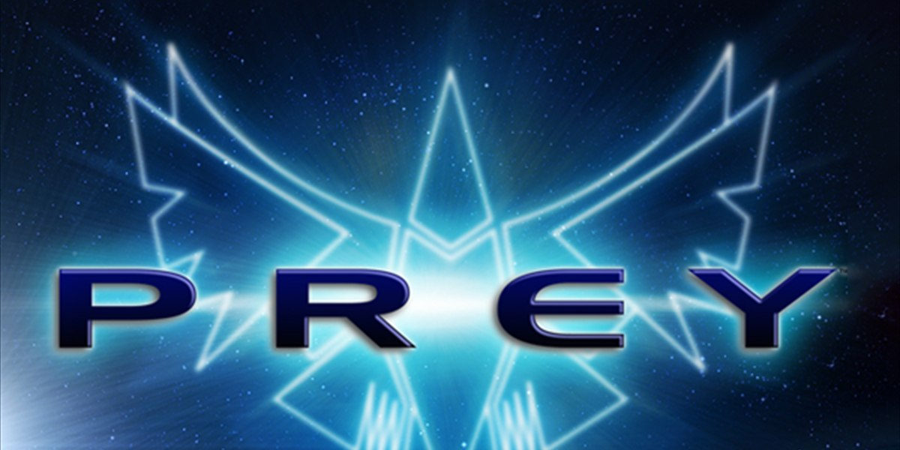

<div align="center">



# PreyNX

**Prey (2006) on Nintendo Switch**

Unofficial Nintendo Switch port of **Prey** (2006), built on the
[openPREY](https://github.com/themuffinator/openPREY) source port, with a native
[deko3D](https://github.com/devkitPro/deko3d) renderer.

[](#)
[](#)
[](#)
[](#)

</div>

---

> [!WARNING]
> Work in progress. It builds, but has not been played from start to finish yet.
> See [Status](#status).

This repository has no game files. You need your own copy of Prey.

## What you need

- A Switch with Atmosphère and [sphaira](https://github.com/ITotalJustice/sphaira)
- Your own copy of **Prey** (the three PC discs and the 1.4 patch)
- About 2.2 GB free on the SD card

On a PC, for the first install: Python 3 and [devkitPro](https://devkitpro.org/wiki/Getting_Started)
with `uam`, which turns the game's shaders into the Switch's format.

## Installing

1. Extract the game's files from your discs and patch:

   ```bash
   python tools/extract_game.py "<folder with your .iso and patch>" game_data/base
   ```

2. Compile the game's shaders:

   ```bash
   python tools/build_shaders.py game_data/base game_data/shaders
   ```

3. Build `SD_CARD/`:

   ```bash
   python tools/make_sd.py --nro prey.nro --base game_data/base --shaders game_data/shaders
   ```

4. Copy what is inside `SD_CARD/` to the root of your SD card.
5. Start **Prey** from the homebrew menu. For the full memory the game needs, start it
   through a forwarder or with title takeover, not from the album.

To update, replace `prey.nro` in `sd:/switch/prey/`.

## Controls

| Switch | Game |
| --- | --- |
| Left stick | move |
| Right stick | look |
| ZR | fire, use consoles |
| ZL | alternate fire |
| A | jump |
| B | crouch |
| X | reload |
| Y | spirit walk |
| R / L | next / previous weapon |
| D-pad up | lighter |
| D-pad down | crawler grenade |
| D-pad left | center view |
| D-pad right, right stick click | zoom |
| Left stick click | run |
| + | pause |
| − | multiplayer scores |
| + and − together | console |

In menus the left stick moves the pointer, **A** or **ZR** click and **B** goes back. The
touch screen works too.

Every action can be changed: open the console and use `bind`, for example
`bind JOY3 _impulse54`. `JOY1` to `JOY16` are A, B, X, Y, L, R, ZL, ZR, +, −, the two stick
clicks, then D-pad up, down, left and right. Prompts in the game show the Switch's names.

## Logs

The game writes to `sd:/switch/prey/SD_LOG/`:

| File | What it is |
| --- | --- |
| `prey_log.txt` | everything the game printed (`prey_log_previous.txt` is the last run) |
| `prey_crash.txt` | a crash: the address, the call stack, the registers |
| `prey_fatal.txt` | a fatal error's message |

Copy them to `SD_LOG/` in this repository to look at them. For a live log, start the game
with `nxlink -s prey.nro`.

## Status

| Area | State |
| --- | --- |
| Builds (engine, game, native renderer) | Works |
| Data from discs and patch, game shaders | Works |
| Boots on a console or emulator | **Not tested yet** |
| Menus, levels, portals, wall walking, spirit walk | **Not tested yet** |
| Multiplayer | **Not tested yet** |
| 60 fps at 1020/460/1331 MHz | **Not measured yet** |

## Building

With devkitPro's `switch-dev`, `deko3d`, `uam`, `switch-openal-soft` and `switch-zlib`, from its
MSYS2 shell, or from the `devkitpro/devkita64` container:

```bash
./build.sh
```

The result is `build/prey.nro`. How the port is put together is in [docs/](docs/).

## Credits

- [themuffinator](https://github.com/themuffinator) for openPREY
- id Software and Human Head Studios for the engine and the game
- [fincs](https://github.com/fincs) and the devkitPro team for deko3D, uam and libnx

Licensed under the GPLv3, like openPREY. Prey is a trademark of its owners; this project is not
affiliated with them.
